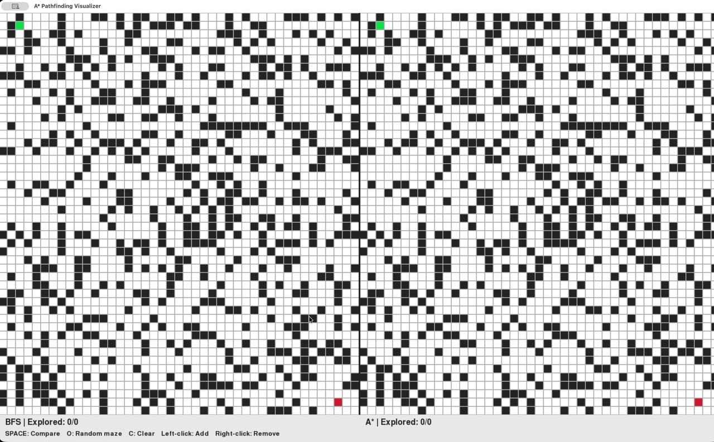
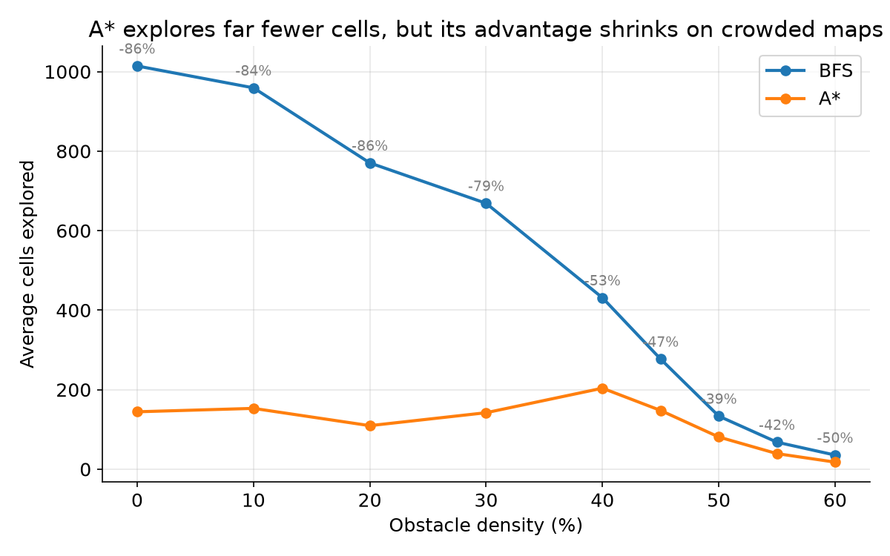
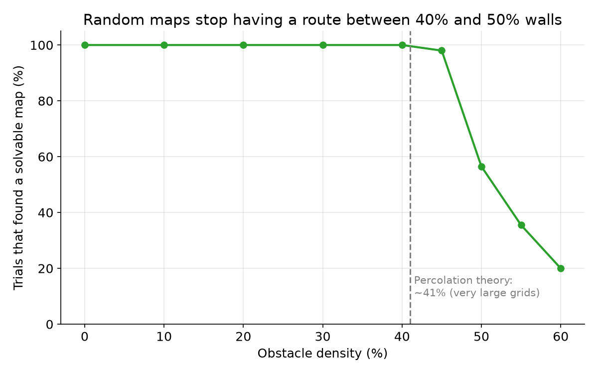
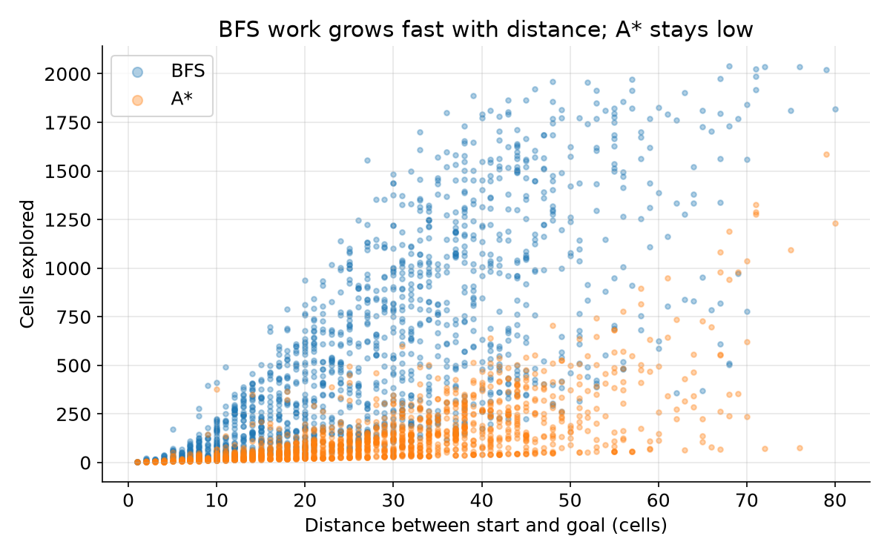

# Path Planner: BFS vs A* on an Occupancy Grid

A mobile robot plans a collision-free path from start to goal on a 2D occupancy grid.
This project runs **Breadth-First Search (BFS)** and **A\*** side by side on the same map, animates both searches in real time, and benchmarks them across 1,400+ random maps to measure **when A\* actually helps, and when random maps stop having a route at all.**



## Key findings

From 200 trials at each of 9 obstacle densities (0% to 60%), with a random start and goal in every trial:

1. **Both algorithms are always optimal.** In all 1,420 solvable trials, BFS and A\* found paths of exactly the same length.
2. **A\* explores ~85% fewer cells on open maps, but the advantage shrinks as maps get crowded.** It saves 86% at 0% obstacles, 53% at 40%, and only 39% at 50%. Walls block the straight line to the goal, so A\*'s distance estimate becomes less accurate and its search starts to look more like BFS.
3. **Random maps stop having a route between 40% and 50% walls.** 100% of trials found a solvable map up to 40% density, but only 57% at 50% and 20% at 60%. This sudden collapse is a *percolation* threshold. Theory predicts it at about 41% walls on very large grids; finite grids blur it upward, which matches what I measured.
4. **Fewer cells doesn't always mean faster.** On open maps A\* runs about 3× faster than BFS. At 45% density their run times are almost equal, even though A\* still explores about half as many cells, because each A\* step costs more (priority queue plus the heuristic calculation).

<p align="center">
  
</p>
<p align="center">
  
  
</p>

**A caveat on high densities:** at 55–60%, only start/goal pairs that happen to be close together ever connect (average distance drops from about 30 cells to about 10). Those trials are mostly short, easy cases, so A\*'s savings appear to rise again there. That's survivorship bias, not a real improvement.

## Results table

| Obstacle density | Trials solvable (of 200) | Avg. tries to generate a solvable map | Avg. cells explored, BFS | Avg. cells explored, A\* | Cells A\* saved |
|---|---|---|---|---|---|
| 0%  | 200 | 1.0  | 1014 | 144 | 86% |
| 10% | 200 | 1.0  | 959  | 153 | 84% |
| 20% | 200 | 1.0  | 770  | 110 | 86% |
| 30% | 200 | 1.1  | 669  | 142 | 79% |
| 40% | 200 | 3.0  | 431  | 204 | 53% |
| 45% | 196 | 18.0 | 277  | 148 | 47% |
| 50% | 113 | 52.1 | 134  | 81  | 39% |
| 55% | 71  | 47.2 | 68   | 39  | 42% |
| 60% | 40  | 45.6 | 36   | 18  | 50% |

## How it works

- **The map as a graph:** each free cell is a node connected to its free neighbors up, down, left and right, using direction vectors like `(-1, 0)` for up.
- **BFS** uses a queue (`deque`) and explores outward in rings from the start. It always finds the shortest path but searches every direction equally.
- **A\*** uses a priority queue (`heapq`) and always expands the cell with the lowest score:
  `score = steps taken so far + Manhattan distance to the goal`
  The estimate pulls the search toward the goal.
- **Path reconstruction:** both algorithms record where each cell was reached from, then walk backwards from the goal to rebuild the route.
- **Random map generator:** places walls randomly at a given density and checks the map with A\*. If there's no route, it tries again, up to 200 times, and records how many tries it needed. That count is how solvability is measured.
- **Benchmark:** for each density, it runs 200 trials. Each trial picks a random start and goal, generates a solvable map, runs both algorithms, and records cells explored, path length, run time and start-to-goal distance in `benchmark_results.csv`. `make_charts.py` turns the CSV into the charts above.

## What broke and how I fixed it

- **Unsolvable maps leaked into the data.** At high densities the generator sometimes failed all 200 tries and quietly left an unsolvable map, which the benchmark then measured. I changed the generator to report success or failure and skip failed trials, and turned the number of tries into its own measurement.
- **Walls were being placed twice.** After rewriting the generator, the old wall-placing code was still there, so every cell got two chances to become a wall. A "45%" map was really about 70% walls, and almost nothing was solvable.
- **The benchmark ignored the density it asked for.** The generator used the fixed setting `DENSITY` instead of its `density` input, so every "0%" test actually ran at 45%. The giveaway was that maps with 0% walls were failing, which should be impossible.
- **The generator gave up after one try.** A `return` was indented inside the retry loop, so it stopped after the first failed map instead of trying 200 times.

## Visualizer

The window shows the same grid twice: **BFS on the left, A\* on the right.**

| Color  | Meaning |
|--------|---------|
| Green  | Start |
| Red    | Goal |
| Black  | Obstacle |
| Yellow | Cells explored by BFS |
| Purple | Cells explored by A\* |
| Blue   | Final shortest path |

| Input | Action |
|-------|--------|
| Left-click | 1st click: start · 2nd click: goal · after that: add walls |
| Right-click | Remove a wall, start or goal |
| `R` | Random start and goal |
| `O` | Generate a random solvable map |
| `SPACE` | Run BFS and A\* and animate the comparison |
| `T` | Run the full benchmark and save `benchmark_results.csv` |
| `C` | Clear everything |

## Run it

```
pip install pygame pandas matplotlib
python3 pathplanner.py      # the visualizer (press T to run the benchmark)
python3 make_charts.py      # build the charts from benchmark_results.csv
```

## What's next

- Run the solvability experiment on 20×20, 50×50 and 100×100 grids to see the threshold sharpen toward 41%
- Diagonal movement
- A robot that only sees nearby cells and replans when it discovers a wall
- Use this planner inside a 2D self-driving car simulator
